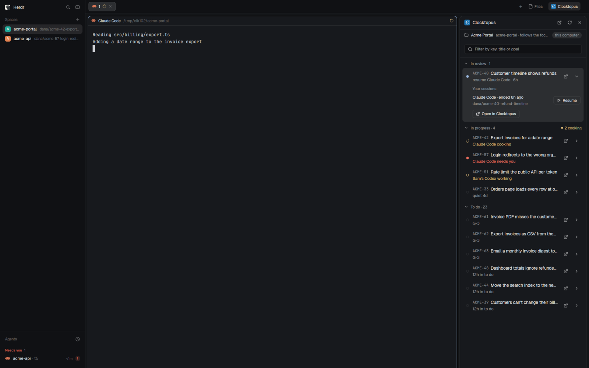

# Clocktopus for Herdr

A [Herdr](https://herdr.dev) layout with a Clocktopus panel beside your agents.
Each space shows the tasks of the project its folder belongs to, in whichever
of your organisations links that repository: ready to ship, in review, in
progress and to do, which ones an agent is working on now, and a click to
bring that agent into view or resume an earlier session from any machine Herdr
reaches. Each task's More actions menu opens a new worktree for its branch, with
a terminal or any installed agent, or the task in Clocktopus.



It needs the Herdr desktop app (`herdr-app` 0.1.13 or newer) and the
Clocktopus CLI with the `tasks` command, signed in (`clocktopus login`) on
each machine your spaces live on. The panel reads everything through the CLI,
so it holds no credentials of its own.

Off production, or on a CLI built from a checkout, a banner under its title
names the environment and the checkout, per space, since each space reads the
CLI of its own machine.

## Add it

Ask the agent you run in Herdr:

```
Read ~/.config/herdr-app/AGENTS.md, then add this layout: https://github.com/blastin-dev/clocktopus-cli/tree/main/apps/cli/herdr
```

Or copy it by hand, then switch to it with `ctrl-shift-l`:

```sh
cp -r mods/clocktopus ~/.config/herdr-app/mods/
cp layouts/clocktopus.json layouts/clocktopus.png ~/.config/herdr-app/layouts/
herdr-app check ~/.config/herdr-app/mods/clocktopus
herdr-app do layout.switch '{"name":"clocktopus"}'
```

[RECIPE.md](RECIPE.md) describes what it shows and does, what it runs and
reads, and how to rebuild it on a newer Herdr.
