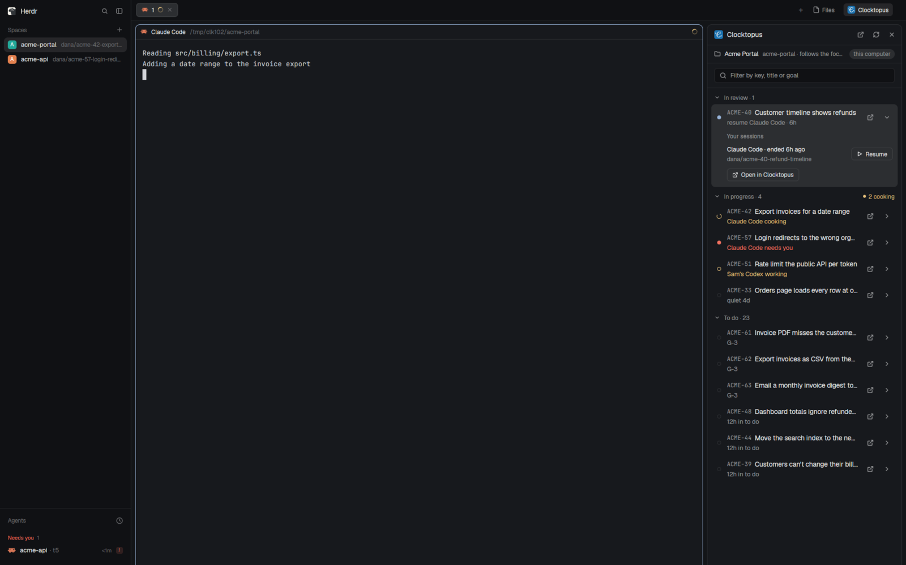

# Herdr + Clocktopus

Herdr's default window with a Clocktopus button in the tab bar and a Clocktopus panel beside the work area. The panel shows the open tasks of the Clocktopus project the shown space's folder belongs to, in whichever of your organisations links it, grouped as Ready to ship, In review, In progress and To do, and marks the ones a Herdr agent is working on with that agent's status. Clicking such a task brings its agent into view; a task whose earlier agent session is on a machine Herdr reaches offers Resume; every task opens in Clocktopus.

## What you see

Left to right, everything as in Herdr's `main` layout, plus two blocks:

- **Sidebar**, 268px: Herdr's own brand bar, Spaces, Agents and footer.
- **Work column**: the tab bar row is `tabs` (weight 1) beside a 128px `clocktopus-toggle` block, which draws the 16px Clocktopus mark (`mark.png`, rounded 4px) and "Clocktopus" in 12px, on `selected` while the panel shows. Under it the shown tab and Herdr's Files/Changes side panel, then the status bar.
- **Clocktopus panel**, a 400px column (320–720px) right of the work area, on `background` with a 1px `border` and 10px corners, top to bottom:
  - a 42px header: the 18px mark, "Clocktopus" in the title size, then 24px icon buttons: open the project's Work page, refresh (a spinning `ring` in `working` while it reads), hide;
  - off production, or on a CLI built from a checkout, an environment banner on `chrome` with a `blocked` bottom border: an `alert` icon and "STAGING · staging.clocktopus.app" (or "Production · clocktopus.app" for a checkout on production) in `blocked` semibold, and "CLI 0.13.0 · checkout ~/…/apps/cli" under it in `muted` for a checkout. It comes from the `environment` that `clocktopus tasks --json` prints beside the board, so each space shows its own machine's;
  - a place row: a folder icon, the project's name in semibold, "<organisation> · <folder>" in `muted`, a 24px button to choose another organisation when one was chosen for this folder, and the machine as a pill ("this computer" for local spaces);
  - a filter field ("Filter by key, title or goal") on `chrome`;
  - when the project has active goals, a wrapping row of 24px pill toggles, one per goal, newest first: its ref in semibold, its title cut at 150px, and how many of its tasks are on the board in `muted`; the full title shows on hover. A picked goal is on `selected` with an `accent` border. With any picked, a quiet Clear ends the row;
  - the list, the only part that scrolls, in four collapsible groups, each headed "<Stage> · n" in `muted` with "n cooking" and a dot in `ansi3` when agents are on its tasks, and, while the group is collapsed, "in view · <key>" in `accent` when it holds the task in view (below):
    - Ready to ship (merged, not yet delivered; the 20 merged most recently, newest first, then "The n merged longer ago are on the Work page."; collapsed until opened, and left out when nothing is merged), In review, In progress (newest activity first), To do (the project's active goals' tasks in goal order, then the newest; 30 shown, "Show n more" for the rest);
    - each row is at least 48px: an 8px marker in a 12px column (a dot, or a 10px spinning `ring`, which draws an 8px circle), the key in the terminal font and `muted`, the title, one line under it, an open-in-Clocktopus icon and a chevron. The marker and line:
      - a Herdr agent on the task: `working` shows a spinning ring and "<Agent> cooking" in `ansi3`, the theme's yellow, since `working` is often blue; `blocked` a dot and "<Agent> needs you" in `blocked`; `done` a dot and "finished" in `done`; `idle` in `idle`. Several agents: the most urgent, and "· n agents";
      - an agent Clocktopus says works on it but Herdr doesn't show: a hollow `ansi3` dot and "<Agent> working outside Herdr", or "<Person>'s <Agent> working" for someone else's;
      - one of your sessions resumable on a machine Herdr reaches: an `accent` dot and "resume <Agent> · 2h", with "· on <machine>" when it is not this computer; one still running outside Herdr: a hollow `ansi3` dot and "<Agent> running outside Herdr";
      - a live Herdr agent whose session the board lists on the task, but which is on another task now: a hollow dot in the agent's status colour and "<Agent> moved on to <key>" in `muted`;
      - otherwise a hollow `border` dot and the goal's ref, "quiet 4d" for a stale task, or how long it has been in its stage.
    - Every row has a 1px border in its own background, 8px corners. The task in view, the one an agent in the window's shown tab is on, has it in `accent` and "· in view" after its agent's state, open or not; a task that agent moved on from has it in `border`.
  - A row opens in place on `raised` across its full width: no marker and no line under the title; the key in the terminal font above the title, which wraps in full. Under it the goal in `muted`, then one list of the task's agents and sessions on `background` with a 1px `border` and 7px corners, 34px lines split by `border` hairlines, no headings: each line an 8px marker, the agent, its state in its colour, then either the space › tab it is in as a bordered tag in the terminal font (space in `muted`) with an arrow, the whole line being the click, or an action in `accent`. Its order: Herdr agents on the task ("· by branch" when matched only by branch), live Herdr agents that moved on from it ("moved on to <key>"), other people's agents ("<Person>'s <Agent>", "working · 12m"), your sessions with something to do (open in a Herdr terminal, a click going to it; running outside Herdr, with Open a copy; resumable on a machine Herdr reaches, "ended 2h ago", with Resume), then the rest ("ended 1d ago · not reachable", or "can't be resumed" for OpenCode). The session's branch and folder are its tooltip. A line for an agent in view has a 1px `accent` border with 7px corners in place of its hairline, reads "· in view" and is no click. When this task's agents' sessions are on other tasks of the board too, "Its session also worked on" follows, with each key as a small button that opens that task's row, opening its group and the whole of To do when it is hidden there. A To do task ends with 22px Start buttons. Open in Clocktopus is the row's icon, never repeated below.
  - a 34px footer: "n in flight · updated 2m ago" (in progress and in review) and, while any agent works, a spinning ring and "n agents working" in `ansi3`.
- When the board can't be read, the panel says why in place of the list: not signed in (Sign in runs `clocktopus login` in a new tab), the CLI missing or too old (Upgrade runs `clocktopus upgrade`), no git checkout, a repository linked to no project (Set it up runs `clocktopus init`), or several organisations linking it (pick one).

## How it behaves

- The panel follows the space the window shows, placed as Herdr's spaces sidebar places it: its first terminal's live folder, else the folder it was made in. That folder's repository decides the project, and so its organisation, whichever of yours it is: the panel runs `clocktopus tasks --json --limit 200` there, on the space's machine. Focusing another pane in the space changes nothing. It refreshes when shown again and does no work while hidden. While shown it refreshes at once when `clocktopus realtime watch` rewrites a board topic's file (`tasks`, `pull-requests`, `agent-sessions`, `time-entries`) under `~/.clocktopus/realtime`, which it waits on with `watchFolder`; it starts that watcher, and renews its lease, with `clocktopus realtime watch --detach` on this computer at each refresh, one watcher serving every space since hints are per user and organisation. Without a hint it refreshes every 30 s, every 5 min while the watcher's `status` file says `connected`.
- Each place (machine and folder) keeps what it showed last, so switching back shows it at once while it refreshes; spaces at one folder share it. The open row, collapsed groups and Show more are the panel's, not the place's: switching to a space at another checkout of the same project keeps the task open.
- Goal toggles narrow every group to the tasks of the goals picked (all of them together); none picked shows everything. Group headers then read "n of total", and To do shows past its 30. The picks are kept in `shared("clocktopus.goals.v1")` by `<machine>|<folder>`, so each place (machine and folder) keeps its own and spaces at one folder share them; a goal that is no longer active is ignored.
- When several organisations link a space's repository, the panel lists them; the one picked is kept in `shared("clocktopus.orgs.v1")` by `<machine>|<folder>` and passed as `--org` from then on.
- An agent belongs to a task when its terminal's `clocktopus.task` label names it (matched by label), else when its session is one Clocktopus has on that task as its current one (matched by session), else when its pane's branch names the task's key (matched by branch). The Clocktopus CLI's agent hook labels its Herdr terminal (`HC_TERMINAL_ID`) with `clocktopus.session` at SessionStart and clears the labels at SessionEnd, for any agent on any machine; the Claude plugin's hooks module sets `clocktopus.session` and `clocktopus.task` (the task the session is tied to now, empty while it has none) after each of its refreshes, which follow every Clocktopus tool call, so a goal run's move to its next task shows at once. For a local Claude Code session with neither label, the session comes from the program's pid (`hc get <t> --json`, `foreground.pid`) and `~/.claude/sessions/<pid>.json`.
- A tab named as the panel names the tabs it opens, a task key or goal ref, or a goal ref then a key ("G-17 · CLK-99"), follows the task its agent is on by label or by session: when it changes, `tab.rename` gives the tab that task's key, after the goal ref when the tab was opened for a goal (a goal of the board, or one already in front). A numbered tab, a tab a person named otherwise, one whose agents are on several tasks, and one matched only by branch keep their names. Each rename is asked for once.
- A To do task an agent is on by label or by session shows In progress at once, before the board's stage follows; To do's count leaves it out.
- An agent is in view when it is in the window's shown tab (`focused().tab`), or is the one an agent block shows (`focused().agent`). A live agent has moved on from a task when the board lists its session there but the agent belongs to another task (`movedOn`): a session tied to several tasks, such as a goal run's, shows on each.
- Clicking a row brings up the agent matched by session with `pane.focus {pane}`, in whichever space and tab it is, or the only agent matched by branch. When that agent is already in view, the click opens or closes the row instead, since focusing it would change nothing; so does a click on a task an agent moved on from. When several tabs match only by branch (one checkout, several agents), the row opens instead and lists each agent with its space and tab, each a line to click. With no agent on it, the click resumes the task's session (below); otherwise the row opens.
- Resume takes the newest of your sessions on the task that is working on it now, else the newest: one not open in Herdr and found on a machine Herdr reaches, the space's machine first, then this computer, then the others. It runs `tab.new {space, folder, argv, name: <key>}` in the space on that machine whose folder is the session's, else `space.new {machine, folder, argv, tab: <key>}`, with `claude --resume <id>` or `codex resume <id>`. Each machine is asked with one `sh` script: the session's folder (home-relative, `~/…`, as the hook reports it) must exist there, and its transcript be there: `~/.claude/projects/<folder with every non-alphanumeric character as ->/<id>.jsonl` (under `CLAUDE_CONFIG_DIR` when set), or a Codex `rollout-*<id>.jsonl` under `~/.codex/sessions`. A Claude Code session whose `~/.claude/sessions/<pid>.json` names a live process is still running, and is never resumed a second time: when that process is a Herdr terminal's foreground program (`hc get <t> --json` on its machine), an agent that reports no status, the row reads "open in a Herdr terminal" and a click runs `pane.focus {terminal}`; otherwise it reads "running outside Herdr", a click opens the row, and the session offers Open a copy, `claude --resume <id> --fork-session` placed as Resume is, which opens its conversation as a new session and leaves the original running. OpenCode keeps its sessions in a database, so it has no Resume.
- A To do row has a play button, and its open row Start buttons, when an agent with the start-work skill is installed on the space's machine: Claude Code, Codex or OpenCode, in `knownAgents({on})`'s order, most picked first, so the first is the default. Start runs `tab.new {space, folder: <the space's folder>, argv: <the agent's run>, task, name}`, the agent's first message (`task`) being the start-work skill on the task: `/clocktopus:start-work <key>` in Claude Code, "Use the clocktopus-start-work skill to start work on <key>." in the others. With one agent and no goal the play button starts at once. Otherwise it opens a 320px-wide popup (`openOverlay {kind: "popup"}`, role `start`) headed "Start work", offering "This task · <key>" with its title and, for a task in an active goal, "The whole goal · <ref>" with the goal's title and open count, each a click with one agent ("Start work with <Agent>"), else each with a 22px button per agent, the default solid; the goal choice starts the skill on the goal's ref, which works through its tasks. The open row shows Start <key> and Start goal <ref> with one agent; with several, a line for each, "Start <key> in" and "Start goal <ref> in", followed by the agents' buttons.
- Open in Clocktopus and the Work page button use `cx.open_url`.
- The toggle and the hide button run `layout.toggle` / `layout.hide {id: "clocktopus-panel"}`. The node's hidden state is a layout click, so the panel stays open or closed across space switches and restarts.

## Built from

- `layouts/clocktopus.json`: a copy of `main` (Herdr 0.1.13, `cloned_from` recorded) with two changes:
  - the tab bar block becomes `{ "id": "tabs-row", "type": "row", "size": { "px": 42 }, "resizable": false, "children": [ the tabs block with "size": { "weight": 1 }, { "id": "clocktopus-toggle", "type": "block", "size": { "px": 128 }, "content": { "mod": "clocktopus", "props": { "role": "toggle" } } } ] }`;
  - `work-body` gains `{ "id": "clocktopus-panel", "type": "column", "size": { "px": 400 }, "min": 320, "max": 720, "children": [{ "id": "clocktopus", "type": "block", "content": { "mod": "clocktopus" } }] }`.
  - Root `"preview": "layouts/clocktopus.png"` is the picture Settings shows.
- `mods/clocktopus/`:
  - `main.js` holds the views: the panel by default, `props.role: "toggle"`, and `"start"` for the start popup.
  - `model.js` holds the decisions, with no Herdr imports: reading the CLI's output, matching agents to tasks, resume commands, the resumable-session script, the filter. `apps/cli/src/lib/herdr-mod.test.ts` tests it.
  - `mark.png` is the Clocktopus icon; `icons/` holds the stroke icons.
- Herdr functions: `exec` with `on`, `hc`, `readTextFile`, `home`; `spaces`, `agents`, `panes`, `focused`, `layout`; `shared` / `setShared`, `watchFolder`, `knownAgents`, `openOverlay` / `closeOverlay`, `theme`, `settings`, `props`, `nextCommand`.
- Commands: `layout.toggle`, `layout.hide`, `pane.focus`, `tab.new`, `tab.rename`, `space.new`.
- Programs: `clocktopus` (the Clocktopus CLI, found on the PATH or in `~/.local/bin`, mise's shims, pnpm's or npm's global folder, `/opt/homebrew/bin`, `/usr/local/bin`), `sh`, `find`, `grep`, `sed` and `kill -0` for the session check on each machine, `hc get`.
- Network: none of its own. The CLI calls Clocktopus with its own sign-in.
- Files read: `~/.claude/sessions/<pid>.json` for live Claude Code agents, and the session check reads those files on each machine to find running sessions; transcripts are only tested for existence.
- Its look is Herdr's: theme tokens only, no theme or fonts of its own.

## Watch out

- The CLI prints one JSON object for every outcome, failures included (`status`: `ok`, `signed_out`, `not_a_repository`, `unsupported_repository`, `no_project`, `choose_organization`, `error`). A CLI without the `tasks` command fails with "unknown command", which the panel reads as too old.
- `cx.notify()` throws during `render`, so work started from `render` waits for the render to end first (`later`).
- QuickJS rejects `??` mixed with `||` or `&&` without parentheses. `herdr-app check` catches it; `node --check` does not.
- `herdr-app check` writes `gpui-kit.d.ts` and `jsconfig.json` into the mod folder; they are ignored, not part of the mod.
- Keep the panel out of the `panel` stack: Herdr's tabs mod restores that stack per space, so a panel there closes on every space switch.
- A layout copy is never updated: rebuild from this recipe on a new Herdr version.

## Done when

- `herdr-app check ~/.config/herdr-app/mods/clocktopus` passes.
- `layout.switch {name: "clocktopus"}` shows the layout with no `clocktopus.error`.
- The tab bar shows Files, Changes and Clocktopus. The Clocktopus button shows the panel, and a second click hides it.
- In a checkout of a repository linked to a Clocktopus project, the panel lists its tasks under In review, In progress and To do, with a collapsed Ready to ship above them once a task's pull request merges, and a Claude Code agent on a task's branch shows on that task's row with its status.
- Clicking that row shows the agent; Resume on a session a machine Herdr reaches has opens it in a new tab in its folder there.
